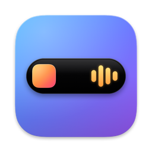
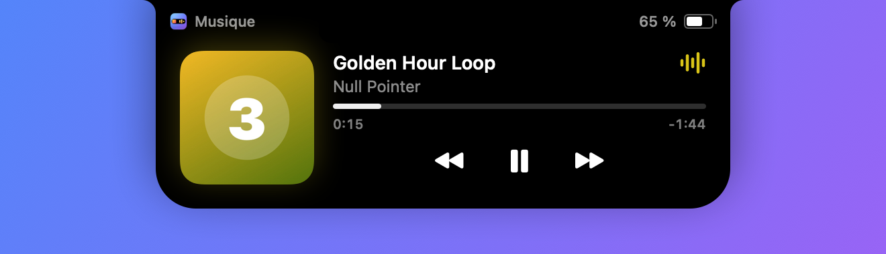
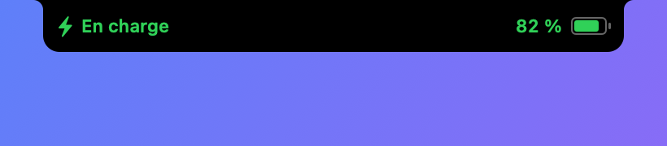

<p align="center">
  
</p>

<h1 align="center">Islet</h1>

<p align="center">
  Une Dynamic Island pour ton Mac. Simple, fluide, en temps réel.
</p>

<p align="center">
  
</p>

Islet transforme l'encoche du MacBook en île dynamique. Elle reste invisible
tant qu'il ne se passe rien, s'anime dès qu'un morceau démarre, que tu changes
le volume ou que tu branches le chargeur, et s'ouvre quand tu passes le pointeur
dessus.

## Ce qu'elle fait

| Activité | Ce que tu vois |
|---|---|
| **Musique en direct** | La pochette et des barres animées de part et d'autre de l'encoche, pour tout ce qui joue sur le Mac : Spotify, Apple Music, YouTube dans Chrome ou Safari, podcasts… |
| **Lecteur complet** | Au survol : titre, artiste, position, précédent / lecture / suivant, et une barre de progression que l'on peut faire glisser. Un clic sur la pochette ouvre l'app qui joue. |
| **Changement de titre** | Le nom du morceau se déroule sous l'encoche quand la lecture change. |
| **Volume** | Le niveau et le mode muet, à chaque changement. |
| **Charge et batterie** | Le branchement du chargeur, puis une alerte à 20, 10 et 5 %. |
| **Sortie audio** | Le nom de l'appareil qui prend le relais : AirPods, casque, écran… |

<table>
  <tr>
    <td></td>
    <td></td>
  </tr>
  <tr>
    <td></td>
    <td></td>
  </tr>
</table>

Islet ne demande aucune autorisation système, n'a pas d'icône dans le Dock et
ne fait rien tant que rien ne change : tout est piloté par des événements du
système, sans interrogation périodique. Mesuré sur un MacBook Pro M5, pointeur
immobile : 0 % de processeur au repos comme pendant la lecture, moins de 1 %
quand l'île est ouverte sur un morceau.

## Installation

Il faut **macOS 14 ou plus récent** et les outils en ligne de commande d'Apple.
Xcode n'est pas nécessaire. Si les outils ne sont pas encore installés :

```bash
xcode-select --install
```

Ensuite, récupère le projet :

```bash
git clone https://github.com/PaulApc94/Islet.git
```

```bash
cd Islet
```

Et installe :

```bash
./install.sh
```

Le script compile l'app (moins d'une minute), la copie dans `/Applications` et
la lance. Comme elle est compilée sur ta machine, macOS ne la bloque pas à
l'ouverture. Il ne demande jamais de mot de passe administrateur : si
`/Applications` n'est pas accessible en écriture, l'app va dans
`~/Applications`.

Pour mettre à jour, relance la même commande après un `git pull`.

## Utilisation

- **Islet se lance toute seule à chaque ouverture de session.** C'est activé au
  premier lancement ; pour l'arrêter, décoche « Lancer au démarrage » dans les
  réglages (Islet ne le réactivera pas dans ton dos).
- **Passe le pointeur sur l'encoche** : l'île gonfle légèrement, puis s'ouvre.
  Éloigne-le et elle se referme.
- **Approche le pointeur d'un menu ou d'une icône que le lecteur recouvre** : il
  se replie derrière l'encoche pour te laisser voir et cliquer, puis revient
  quand le pointeur s'éloigne. Sur un Mac à encoche, l'île fermée ne prend
  jamais un clic destiné à la barre des menus. Les bannières (volume, charge,
  batterie), qui ne durent que quelques secondes, restent affichées.
- **Les réglages** sont dans l'icône en forme de capsule de la barre des menus :
  activer ou non chaque activité (dont la musique), ouvrir au survol ou
  seulement au clic, retour haptique, lancement au démarrage du Mac, quitter.
- **Pour que le lecteur ne recouvre jamais un menu ou une icône**, coche
  « Éviter les icônes de la barre des menus » dans les réglages. Islet mesure
  alors la place libre de chaque côté de l'encoche et n'y étend le lecteur que
  s'il tient : des deux côtés, d'un seul (pochette et barres ensemble s'il y a
  la place), ou pas du tout. Cela demande l'autorisation **Accessibilité**
  (Réglages Système → Confidentialité et sécurité → Accessibilité) : c'est le
  seul moyen qu'offre macOS de savoir où sont les éléments de la barre. Islet ne
  s'en sert que pour lire leur position.
  Pour que macOS conserve cette autorisation d'une mise à jour à l'autre, lance
  une fois `scripts/make-signing-identity.sh`, puis `./install.sh` : le script
  crée dans ton trousseau un certificat local (« Islet Local Signing »,
  auto-signé, sans `sudo` ni réglage de confiance modifié) avec lequel chaque
  version est ensuite signée. macOS peut demander une fois le mot de passe de
  ton trousseau pour laisser `codesign` utiliser la clé : réponds « Toujours
  autoriser ». Autorise Islet une dernière fois après cette installation ; les
  suivantes gardent l'autorisation.
- **Si l'icône a disparu** (macOS cache derrière l'encoche les icônes qui ne
  tiennent pas dans la barre des menus) : fais un clic droit sur l'île, ou
  relance Islet depuis Spotlight. Le même menu s'ouvre.
- **Sur un Mac sans encoche** (ou un écran externe seul), l'île se dessine en
  haut de l'écran, au centre : vise le bord supérieur pour l'ouvrir. Là, la
  pastille est l'île elle-même : elle ne se replie pas, et un clic dessus
  l'ouvre.
- L'île s'efface pendant Mission Control et reste visible au-dessus des apps en
  plein écran.

L'interface est en français si le français passe avant l'anglais dans les
langues préférées du Mac, en anglais sinon.

## Désinstallation

```bash
./uninstall.sh
```

Le script ferme l'app, retire son lancement au démarrage, supprime `Islet.app`
(y compris une copie compilée dans le dossier `build/` du projet) et efface ses
réglages.

## Sous le capot

Tout est en Swift (SwiftUI pour le dessin, AppKit pour la fenêtre), sans
dépendance externe.

```
Sources/Islet/
├── main.swift, AppDelegate.swift      démarrage, instance unique
├── IslandModel.swift                  l'état de l'île et la géométrie de chaque état
├── IslandWindowController.swift       le panneau transparent épinglé sur l'encoche
├── StatusItemController.swift         l'icône et le menu de réglages
├── Models.swift, Settings.swift       types partagés, préférences
├── Services/
│   ├── NowPlayingService.swift        lecture en cours (voir ci-dessous)
│   ├── AudioService.swift             volume et sortie audio (CoreAudio)
│   └── BatteryService.swift           batterie et chargeur (IOKit)
└── Views/                             la forme, les bannières, le lecteur
Bridge/IsletBridge.m                   le pont vers « À l'écoute » de macOS
```

Quelques choix qui expliquent le comportement :

- **Une fenêtre fixe, une forme qui bouge.** Le panneau transparent ne change
  jamais de taille ; seule la silhouette noire dessinée dedans s'anime, avec des
  ressorts SwiftUI. Le panneau laisse passer tous les clics, sauf quand le
  pointeur est sur l'île. Le survol est détecté en écoutant les déplacements du
  pointeur : l'app n'est réveillée que lorsque la souris bouge.
- **La lecture en cours passe par un pont.** Depuis macOS 15.4, le framework
  privé `MediaRemote` ne répond plus qu'aux processus de confiance d'Apple.
  Islet lance donc `/usr/bin/perl`, qui en fait partie, pour charger une petite
  bibliothèque (`Bridge/IsletBridge.m`) : elle diffuse l'état de lecture en
  JSON et relaie les commandes. C'est ce qui permet de voir n'importe quelle
  app, navigateurs compris, sans aucune autorisation.
- **Les barres audio sont animées par Core Animation**, pas par l'app : c'est le
  serveur de rendu du système qui calcule les images, et l'app reste au repos
  même quand la musique joue pendant des heures.

## Limites connues

- `MediaRemote` est une API privée : une future version de macOS peut casser
  l'affichage de la lecture en cours. Le reste (volume, batterie, sortie audio)
  n'en dépend pas.
- La bannière de volume s'ajoute à l'indicateur de macOS, elle ne le remplace
  pas. Aux butées (volume déjà à 0 ou au maximum), rien ne change, donc rien ne
  s'affiche.
- Les barres audio sont décoratives : elles ne suivent pas le signal réel, ce
  qui demanderait l'autorisation d'enregistrer l'écran.
- **Les menus et les icônes de la barre des menus ne se décalent pas** quand
  l'île s'étend. macOS place ces éléments autour de l'encoche physique et ne
  donne aux apps aucun moyen de les déplacer, ni même de savoir où ils sont sans
  l'autorisation Accessibilité. Pendant la lecture, l'île déborde d'environ 44
  points de chaque côté de l'encoche et peut donc masquer le menu ou l'icône
  voisin. Islet fait ce qui reste possible : par défaut elle se replie dès que
  le pointeur s'en approche, et avec l'option « Éviter les icônes de la barre
  des menus » elle ne s'étend que là où il y a de la place.
- Cette option a deux limites. Tant que `scripts/make-signing-identity.sh` n'a
  pas été lancé, l'app est signée « ad hoc » : sa signature change à chaque
  compilation, et macOS oublie l'autorisation Accessibilité à chaque mise à
  jour (il faut alors retirer Islet de la liste dans Réglages Système, puis
  l'autoriser de nouveau). Une fois le script lancé, Islet réinstallée et
  autorisée une dernière fois, l'autorisation est conservée, sur ce Mac et tant
  que le certificat reste dans le trousseau (il est valable dix ans ; si la
  signature avec lui échoue, l'app est de nouveau signée « ad hoc » et
  `./install.sh` le signale). Et seul le lecteur compact est ajusté : l'île
  ouverte, qui s'étend dans la barre de part et d'autre de l'encoche tant que le
  pointeur est dessus, et les bannières (volume, charge, batterie, sortie
  audio), qui ne durent que quelques secondes, passent encore par-dessus.
- Développée et vérifiée sur un MacBook Pro 14" (puce Apple, macOS 27). La
  disposition sans encoche n'a été vérifiée qu'en simulation, et les Mac Intel
  n'ont pas été testés.
- Islet se concentre sur l'île elle-même. Elle n'a ni widgets d'écran
  verrouillé, ni paroles synchronisées, ni météo, ni application compagnon.

## Développement

```bash
make build
```

compile et assemble `build/Islet.app` ; `make run` la lance directement,
`make test` exécute les tests de la logique (états de l'île, géométrie,
position de lecture) et `make clean` efface les produits de compilation.

Une seule Islet tourne à la fois : une deuxième se ferme aussitôt, après avoir
demandé à la première d'ouvrir son menu. `make run` arrête donc la version
installée. Pour la retrouver ensuite, relance `./install.sh`, ou quitte la
copie de développement (clic droit sur l'île, « Quitter Islet ») puis rouvre
Islet depuis le dossier Applications.

Deux outils évitent d'avoir à toucher au matériel pour tester :

- `swift scripts/dev/fake-player.swift` s'enregistre comme lecteur auprès de
  macOS avec trois faux morceaux, sans émettre de son. Pratique pour tester le
  lecteur et ses commandes.
- Lancée avec `ISLET_DEBUG=1 make run`, l'app obéit à
  `scripts/dev/islet-debug.sh` : `expand`, `collapse`, `hover`, `unhover`,
  `volume`, `mute`, `charging`, `low`, `output`, `track`, et
  `snapshot:/chemin/absolu.png`, qui fait dessiner l'île par l'app elle-même
  dans une image (les captures de ce README viennent de là). `toggle`, `next` et
  `previous` appuient sur les boutons du lecteur : ils agissent sur ce qui joue
  vraiment, donc à utiliser avec le faux lecteur. Ajoute `ISLET_NOTCHLESS=1`
  pour simuler un Mac sans encoche.
- Attention : ces images ne montrent que l'île, pas les autres fenêtres. Pour
  savoir si quelque chose la recouvre (la barre des menus, par exemple), il faut
  regarder l'écran lui-même.

À savoir avant de contribuer : avec le SDK de macOS 27, l'attribut `@State` de
SwiftUI est une macro dont le plugin n'est livré qu'avec Xcode. Pour que le
projet reste compilable avec les seuls outils en ligne de commande, l'état local
des vues passe par `ViewState` (voir `Views/Components.swift`).

## Licence

[MIT](LICENSE)
